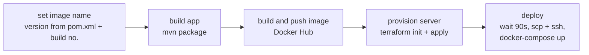
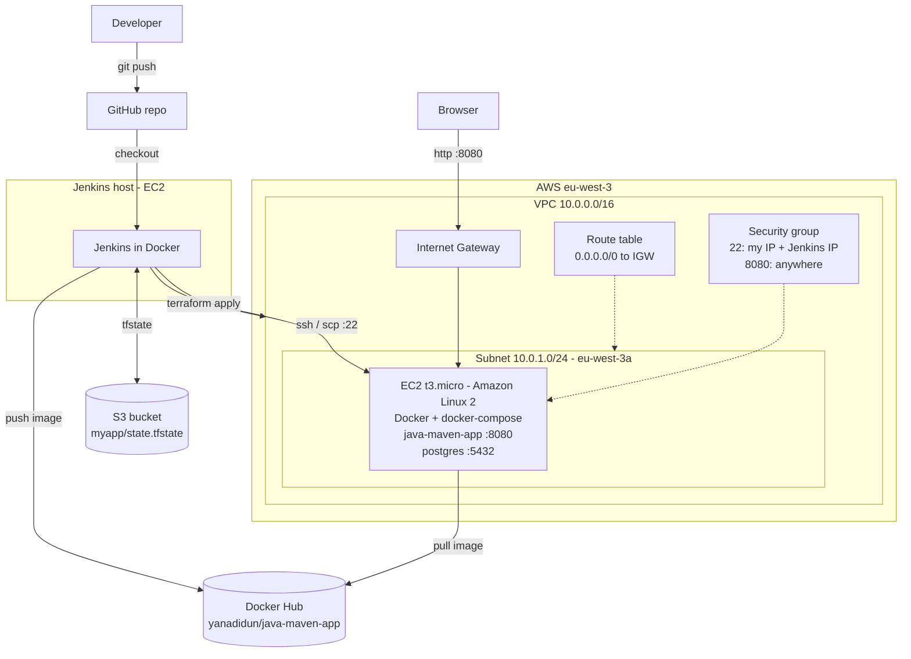

# CI/CD with Jenkins, Terraform & Docker Compose on AWS

A Jenkins pipeline that builds a Java Maven app, pushes it as a Docker image to Docker Hub, provisions an EC2 server with Terraform, and deploys the app there with Docker Compose — all in one run.

## Pipeline



| Stage | What happens |
|---|---|
| **set image name** | Reads the version from `pom.xml` and tags the image as `yanadidun/java-maven-app:<version>-<build number>` |
| **build app** | Builds the JAR with Maven (`buildJar()` from the shared library) |
| **build and push image** | Builds the Docker image, logs in and pushes it to Docker Hub (shared library functions) |
| **provision server** | Runs `terraform init` and `terraform apply` in `terraform/`, then reads the new server's public IP from the `ec2_public_ip` output |
| **deploy** | Waits 90 s for the server's startup script to install Docker, copies `server-cmds.sh` and `docker-compose.yaml` to the server, and runs `docker-compose up` there |

## Infrastructure



**Created by Terraform (`terraform/main.tf`):**

- **VPC** `10.0.0.0/16` with one **subnet** `10.0.1.0/24` in `eu-west-3a`
- **Internet gateway** and the VPC's default **route table** pointing `0.0.0.0/0` to it
- Default **security group**: SSH (22) only from my IP and the Jenkins server, app port 8080 open to everyone
- **EC2 instance** (`t3.micro`, latest Amazon Linux 2 AMI, key pair `myapp-key-pair`) with a public IP
- `entry-script.sh` runs as user data on first boot and installs Docker and docker-compose

**Terraform state** is stored remotely in S3, so every pipeline run sees the same infrastructure.

## Project structure

```
├── Jenkinsfile            # pipeline: build → push → provision → deploy
├── Dockerfile             # app image (eclipse-temurin 8 JRE)
├── docker-compose.yaml    # app + postgres, started on the EC2 server
├── server-cmds.sh         # runs on EC2: docker login + docker-compose up
├── pom.xml                # Maven build, holds the app version
└── terraform/
    ├── main.tf            # S3 backend, VPC, subnet, IGW, routes, SG, EC2
    ├── variables.tf       # region, CIDRs, AZ, instance type, allowed IPs
    └── entry-script.sh    # EC2 user data: installs Docker + docker-compose
```

## Jenkins setup

**Plugins:** Pipeline, Git, SSH Agent, Docker Pipeline

**Tools:** Maven installation named `maven3.6`, plus `terraform` and `docker` available on the Jenkins host

**Shared library:** [`jenkins-shared-library`](https://github.com/yanaddn/jenkins-shared-library)

**Credentials:**

| ID | Kind | Used for |
|---|---|---|
| `github-creds` | Username with password | Loading the shared library |
| `docker-creds` | Username with password | Docker Hub login (Jenkins and EC2) |
| `jenkins-aws-access-key-id` | Secret text | Terraform → AWS |
| `jenkins-aws-secret-access-key` | Secret text | Terraform → AWS |
| `ec2-server-key` | SSH Username with private key | SSH into the EC2 server (`myapp-key-pair`) |

**AWS prerequisites** (created once, outside Terraform):

- S3 bucket for the Terraform state
- EC2 key pair named `myapp-key-pair`
- IAM user for Jenkins with EC2 and S3 permissions

## Expected result

After a successful run the app is reachable at:

```
http://<ec2_public_ip>:8080
```

## Final outcome

### Jenkins server
```
yana@local % ssh -i ~/.ssh/aws-demo-keys.pem ubuntu@51.44.21.187

ubuntu@ip-172-31-13-130:~$ docker ps
CONTAINER ID   IMAGE                 COMMAND                  CREATED      STATUS      PORTS                                                                                                 NAMES
01ae5a75940c   jenkins/jenkins:lts   "/usr/bin/tini -- /u…"   2 days ago   Up 2 days   0.0.0.0:5000->5000/tcp, [::]:5000->5000/tcp, 0.0.0.0:8080->8080/tcp, [::]:8080->8080/tcp, 50000/tcp   keen_mendel
```
### Jenkins pipeline 


### Docker hub with artifacts


### Created EC2 instance via Terraform 
```
yana@local % ssh -i ~/.ssh/myapp-key-pair.pem ec2-user@15.237.137.239

[ec2-user@ip-10-0-1-132 ~]$ docker ps
CONTAINER ID   IMAGE                                 COMMAND                  CREATED       STATUS       PORTS                                       NAMES
5bba29bbd989   postgres:13                           "docker-entrypoint.s…"   2 hours ago   Up 2 hours   0.0.0.0:5432->5432/tcp, :::5432->5432/tcp   ec2-user-postgres-1
181b1a44d60c   yanadidun/java-maven-app:1.1.453-27   "/__cacert_entrypoin…"   2 hours ago   Up 2 hours   0.0.0.0:8080->8080/tcp, :::8080->8080/tcp   ec2-user-java-maven-app-1
```
### AWS S3 bucket with `.tfstate` file


### Running app in web browser


## Clean up

To delete everything Terraform created (run in `terraform/` with the same AWS credentials):

```bash
terraform destroy -auto-approve
```
